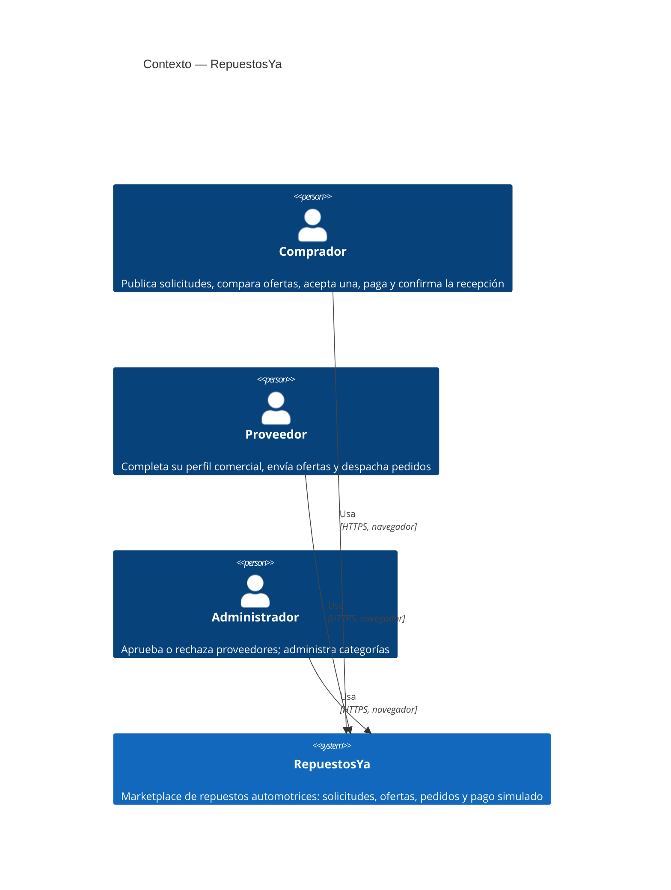
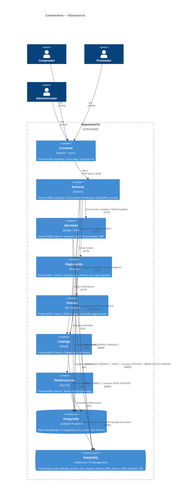

# Diagramas C4 — RepuestosYa

Contexto y contenedores, en Mermaid. Coinciden 1 a 1 con
`docker-compose.yml` (9 servicios: 2 de infraestructura + 7 de aplicación)
y `docs/arquitectura.md`.

## Contexto

## Contenedores

## Notas

- El frontend y el Gateway son los **únicos** contenedores con puerto
  publicado fuera de Docker (4200 y 4000); el resto se llama por nombre de
  contenedor dentro de la red de Compose (`docker-compose.yml`).
- Un solo contenedor de PostgreSQL con 5 esquemas, no 5 bases — decisión D3
  de `docs/decisiones.md`.
- RabbitMQ (UI de management en el 15672) se expone **solo para la demo**,
  no es parte del tráfico normal de la aplicación.

Fuente: `docker-compose.yml` y `docs/arquitectura.md` (tablas de servicios
y de comunicación). Si alguno de los dos cambia, este diagrama debe
actualizarse en el mismo PR.
